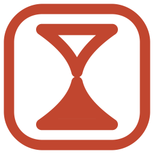
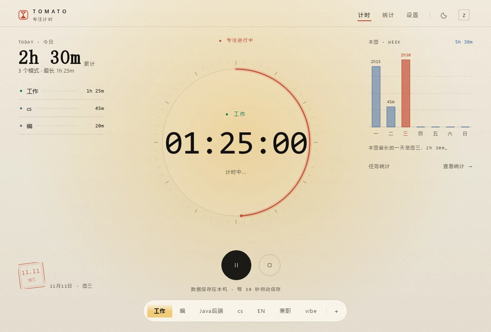
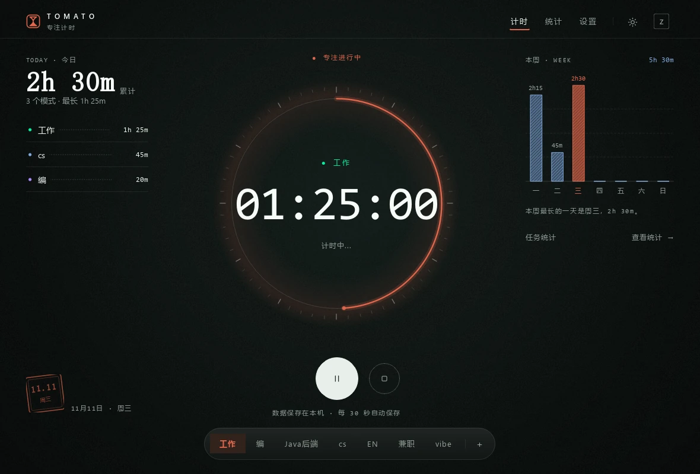
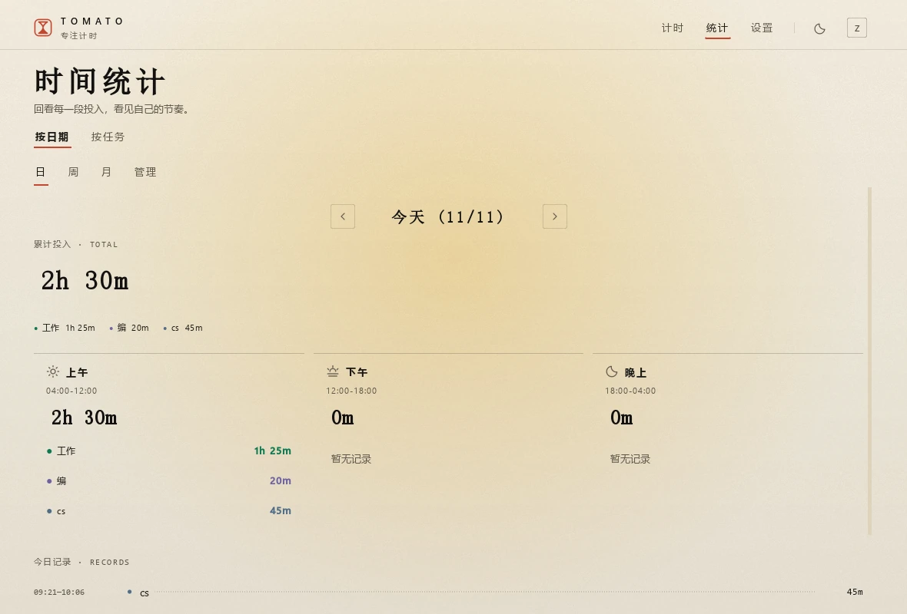
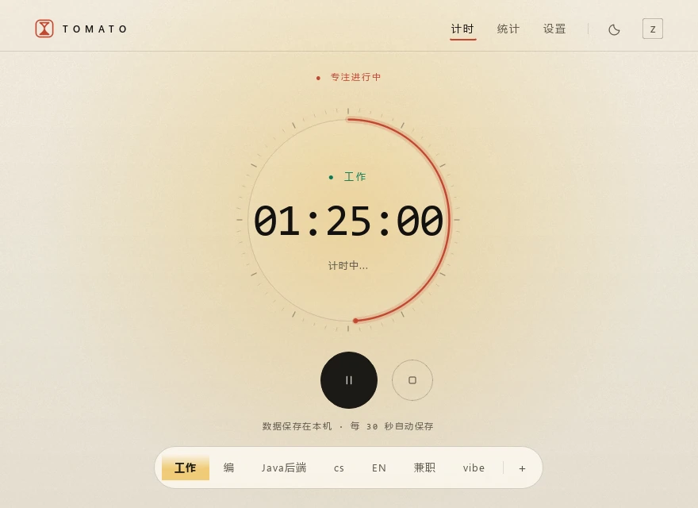

<div align="center">



<h1>Tomato Timer</h1>

<p><strong>一张纸，一支墨，一枚朱砂。</strong><br>
Windows 桌面上的本地专注计时器 —— 每一段投入都记在这台电脑里。</p>

<p>
<a href="https://www.python.org/"></a>
<a href="https://doc.qt.io/qtforpython-6/"></a>

<a href="#testing"></a>
<a href="LICENSE"></a>
</p>

<a href="#quickstart">快速开始</a> ·
<a href="#manual">使用手册</a> ·
<a href="#shortcuts">快捷键</a> ·
<a href="#data">数据与隐私</a> ·
<a href="#faq">常见问题</a> ·
<a href="#design">设计与实现</a>

</div>



<p align="center"><sub>浅色 · 日光纸 —— 中间是今天这一轮专注，左边是今天的账本，右边是本周的投入。</sub></p>

## 为什么是 Tomato

市面上的时间追踪器大多在替「团队」记录，Tomato 只替你自己记录。它假设你每天要切换十几次状态，但不想为此打开浏览器、登录账号、看一堆仪表盘。

- **本地优先。** 记录写进本机一个 SQLite 文件，没有账号体系、没有同步队列、没有服务端。断网、注销、换 Wi-Fi 都不影响计时。
- **04:00 才换日。** 凌晨一点的那段专注算「昨天」，符合熬夜写代码或复习的真实作息。计时页、历史统计、按任务统计三处共用同一口径，不会互相打架。
- **低打扰。** 全局快捷键开始/暂停/结束，最小化后只剩一枚悬浮窗，关窗口即收进托盘。你不需要为了看一眼还剩多久而切换窗口。
- **看得见的手感。** 界面没有卡片堆叠和仪表盘，只有纸面、发丝线和自绘的刻度圆环。所有图形由 QPainter 画出来，缩放不糊。

## 功能一览

**计时**

- 多模式计时：工作、学习、副业各成一类，随时新增、改名、换色；切换模式会先结清上一段。
- 累计不丢：同一天同一模式的多段自动相加，每 30 秒自动落盘。
- 结束不清零：结束只结清本段，当天累计继续留在页面上。
- 圆环进度：取「本轮连续专注 ÷ 提醒间隔」，暂停或结束时归零。

**统计**

- 按日期：日、周、月、管理四个视图，日期可前后翻页；同一天的模式合并显示，多模式时补每日总计与分时段明细。
- 按任务：选一个模式标签，看今日、本周、本月、全部记录或自定义区间；给出累计专注、专注天数、专注日均、单日最高、时段占比与趋势。
- 时段拆分：上午 04:00–12:00、下午 12:00–18:00、晚上 18:00–次日 04:00。跨时段记录按实际秒数拆开，暂停时间不计入。
- 斜纹柱状图：悬浮显示完整日期、星期与累计时长，带高亮与生长动效。

**桌面集成**

- 全局快捷键：窗口不在前台也能暂停、结束、切换模式。
- 悬浮窗：可拖动、双击回主窗，还能开启「时间玻璃遮罩」把读数糊住，只留模式与运行状态。
- 系统托盘：关闭窗口最小化到托盘，退出时自动保存当前段。
- 工作节奏提醒：到达设定时长后，在屏幕正中弹一张提醒卡，文案可自定义，关闭前一直保留。
- 单实例：重复启动不会开出第二个窗口，而是聚焦已运行的那个。

**外观**

- 两套纸张：日光纸 `#F3ECDE` 与夜间纸 `#0A0E0D`，同一套颜色令牌互换。
- 八枚强调色：默认朱砂，另有明亮蓝、Dracula 紫、Nord 冰青、蜜桃橙、玫瑰粉、清新绿、薄荷绿。
- 自绘控件：刻度圆环、账本行、斜纹柱、印章日期、编号目录都由 QPainter 绘制，1040px 以下自动收起左右两列。

## 界面

<p align="center">


</p>

<p align="center"><sub>夜间纸 —— 底色保持中性，只有圆环带一圈柔光　·　统计 —— 累计、分时段与今日记录</sub></p>

<p align="center">

</p>

<p align="center"><sub>窄至 880 × 640：左右两列收起，只留圆环与模式胶囊</sub></p>

<a name="quickstart"></a>

## 快速开始

### 环境要求

- Python 3.10+（开发环境为 3.13）
- 依赖：PySide6、pynput
- Windows 10/11 为主要目标；macOS / Linux 可跑源码版，但托盘、全局快捷键与打包表现受系统权限和桌面环境影响

### 从源码运行

```bash
git clone https://github.com/hezhen20/tomato.git
cd tomato
```

Windows PowerShell：

```powershell
python -m venv .venv
.\.venv\Scripts\Activate.ps1
pip install -r requirements.txt
python main.pyw
```

macOS / Linux：

```bash
python3 -m venv .venv
source .venv/bin/activate
pip install -r requirements.txt
python main.py
```

`main.pyw` 与 `main.py` 等价，只是 Windows 下不弹控制台窗口。

### 首次启动

输入任意用户名和密码即完成本地注册，之后用同一组凭据登录。密码以加盐 SHA-256 存在本机数据库里，只作轻量入口，不承担高安全等级账户系统的职责。

<a name="manual"></a>

## 使用手册

### 1. 开始一段专注

打开应用后有三种方式启动：

- 点圆环下方的黑色按钮：没有选中模式时，它会启动列表里的第一个模式。
- 点底部胶囊里的某个模式：直接以该模式开始。
- 按该模式绑定的全局快捷键：任何窗口下都能触发。

计时中，黑色按钮变成暂停，右侧方块按钮用于结束本段。状态文字会明确写出「计时中」「已暂停」「就绪」。

### 2. 管理模式

设置 → 模式管理。可以新增、改名、换色、删除。模式颜色会同步到计时页的账本圆点、统计页的明细与悬浮窗状态点。

改名不会丢历史：记录挂在模式 ID 上，只换显示名。删除模式会连带删除它的历史记录，操作前请确认。

### 3. 查看统计

统计页顶部有两组切换：

- **按日期 / 按任务**：前者看一天或一段时间的整体分布，后者聚焦某一个模式标签。
- **日 / 周 / 月 / 管理**（按日期下）：管理视图可以按时间范围批量删除记录。

按任务视图支持今日、本周、本月、全部记录和自定义起止日期，左右箭头翻相邻时段，「回到本期」回到当前日期。统计读取已保存的记录，计时中约每 30 秒刷新一次，也可以手动刷新；切换统计范围不影响正在跑的计时。

<a name="shortcuts"></a>

### 4. 快捷键

| 操作 | 默认组合 | 说明 |
| --- | --- | --- |
| 暂停 / 恢复 | `Ctrl + Alt + P` | 全局生效，窗口不在前台也可以 |
| 结束当前段 | `Ctrl + Alt + Q` | 结清本段，当天累计不清零 |
| 切换页面 | `Alt + 1` / `Alt + 2` / `Alt + 3` | 计时 / 统计 / 设置 |
| 模式快捷键 | 设置 → 全局快捷键 | 每个模式可绑定独立组合键 |

模式快捷键随状态变化：

- 没在计时：按下即开始该模式。
- 正在该模式计时：按下即暂停 / 恢复。
- 正在别的模式计时：先结清当前段，再切到目标模式。

录入时先按下修饰键（Ctrl / Alt / Shift）再按主键，`Esc` 取消。如果组合键没反应，通常是已被其他软件占用，换一组并保存即可。

### 5. 悬浮窗、托盘与提醒

- **悬浮窗**：关闭主窗口后出现在桌面上的小窗，可拖动摆放，双击回到主窗口。开启「时间玻璃遮罩」会用高不透明层盖住读数，只保留模式名与运行状态。
- **托盘**：右键托盘图标可以「显示」或「退出」。退出时会保存当前段，不必先回主窗口结束。
- **工作节奏提醒**：设置 → 休息提醒。到达间隔后在屏幕正中弹出提醒卡，可自定义文案；「暂停宽限期」内的短暂暂停仍算同一轮，超过则下一轮重新计时。

### 6. 切换外观

设置 → 外观，或点导航栏右侧的月亮 / 太阳按钮快速切换明暗。明暗与强调色独立选择，点击即生效并即时保存，下次启动在登录页就会恢复。

<a name="data"></a>

## 数据与隐私

所有记录都存在本机的一个 SQLite 文件里，应用不联网、不上传、不统计。

| 系统 | 路径 |
| --- | --- |
| Windows | `%LOCALAPPDATA%\TomatoTimer\tomato.db` |
| macOS | `~/Library/Application Support/TomatoTimer/tomato.db` |
| Linux | `$XDG_DATA_HOME/TomatoTimer/tomato.db`（默认 `~/.local/share/...`） |

- **备份**：复制这个 `tomato.db` 即可；换电脑时放回同一路径就能继续用。
- **重置**：退出应用后删除该文件，下次启动会重新初始化默认模式。
- **账号**：本地账户只是入口，密码以加盐哈希存储；应用不做多账号数据隔离，记录属于这台电脑上的同一份库。

## 打包

```powershell
# Windows：输出 dist\TomatoTimer\
.\build.bat
```

```bash
# macOS / Linux
chmod +x build.sh && ./build.sh
```

打包产物是「文件夹式」应用：把整个 `dist\TomatoTimer\` 复制到另一台同系统的电脑即可运行，不需要安装 Python。图标由 `assets/app.ico` 提供，它会通过 `TomatoTimer.spec` 内嵌进可执行文件；若改动了 `components.py` 里的印章绘制，运行 `python tools/build_app_icon.py` 重新生成。

<a name="design"></a>

## 设计与实现

界面语言是「纸与光」：暖色纸面、墨色正文、发丝线，加一枚朱砂强调色。没有侧边栏、圆角卡片和数据表格，导航是一行目录，数据用点线账本表达。

- `app/ui/theme.py` — 纸墨语义令牌、八枚强调色、明暗两套色板
- `app/ui/materials.py` — 预渲染纸面（底色、暖光、噪点）并按主题缓存
- `app/ui/components.py` — `RingDial`、`LedgerRow`、`HatchChart`、`Seal`、`IndexButton` 等自绘控件，以及沙漏印章标识
- `app/ui/style.qss` — 统一控件状态

更完整的视觉决策（对比度、光学尺寸、字号分工）见 [DESIGN.md](DESIGN.md)。

<details>
<summary>项目结构</summary>

```text
tomato/
├── main.py / main.pyw      入口（.pyw 无控制台窗口）
├── dev.py                  开发热重载入口
├── TomatoTimer.spec        PyInstaller 配置（内嵌 assets/app.ico）
├── build.bat / build.sh    打包脚本
├── assets/
│   ├── app.ico             应用图标（16–256px 九尺寸）
│   └── screenshots/        README 截图
├── tools/
│   └── build_app_icon.py   重新生成 app.ico
├── app/
│   ├── database.py         SQLite 数据层与统计口径
│   ├── hotkeys.py          pynput 全局快捷键
│   └── ui/
│       ├── theme.py        纸墨令牌与强调色
│       ├── materials.py    纸面底图缓存
│       ├── components.py   自绘控件与图标
│       ├── style.qss       统一控件样式
│       ├── main_window.py  主窗口、导航、托盘
│       ├── main_page.py    计时主页
│       ├── history_page.py 统计页
│       ├── settings_page.py 设置页
│       ├── floating_ball.py 悬浮窗
│       └── break_reminder.py 休息提醒
└── tests/                  unittest 用例
```

</details>

<a name="testing"></a>

### 测试

```bash
python -m unittest discover -s tests -t .
```

98 个用例覆盖统计日口径（含 04:00 跨日切分）、自增与自动保存不重复计入、删除记录后重算、主题对比度、快捷键录入优先级、登录注册、窄窗口与长模式名、悬浮窗恢复，以及独立进程中的完整启动与退出。测试使用临时数据库，不会碰正式记录。Qt 用例默认走离屏平台。

需要真实桌面才能验证的部分（系统级快捷键注册、托盘菜单、多屏拖动）仍需人工过一遍。

### 开发

```bash
pip install -r requirements-dev.txt
python dev.py
```

改 Python 或 QSS 后会自动重启应用。它采用整进程重启，未落盘的最近几十秒可能丢失，仅用于调试。

<a name="faq"></a>

## 常见问题

**关了窗口，应用不见了？**

它收进了系统托盘，没有退出。点托盘图标右键「显示」可以召回；右键「退出」才会真正结束并保存。

**凌晨的记录为什么算昨天？**

这是 04:00 统计日口径：`00:00–04:00` 属于前一天的「晚上」。这样熬夜的连续工作不会被零点切成两段。

**快捷键按了没反应？**

先确认在设置页点过「保存快捷键」；再检查是否被其他软件占用。macOS 需要在系统设置里授予辅助功能 / 输入监听权限。

**换电脑怎么迁移？**

复制 `tomato.db` 到新机器同一路径即可，模式和记录一起带走。

**数据会被上传吗？**

不会。应用没有网络请求，也没有账号服务器。

**支持多用户吗？**

可以在登录页用不同用户名进入，但数据不做隔离——它们是同一份本地数据库。

## 致谢

配色参考 [Catppuccin](https://github.com/catppuccin/palette)、[Dracula](https://github.com/dracula/dracula-theme)、[Nord](https://github.com/nordtheme/nord)；布局与信息层级参考 [Folo](https://github.com/RSSNext/Folo)、[Kanri](https://github.com/kanriapp/kanri) 等桌面产品。图标与字体许可见 [THIRD_PARTY_NOTICES.md](THIRD_PARTY_NOTICES.md)。

## License

[MIT](LICENSE) © 2026 zhen

---

## About

Tomato Timer is a local-first focus timer for the Windows desktop. It records every session into a single SQLite file on your own machine — no account server, no sync, no telemetry.

The interface is built as a sheet of paper: warm stock, ink text, hairline rules and one vermilion accent, drawn entirely with QPainter so nothing blurs when the window scales. A statistical day starts at 04:00, which keeps late-night sessions on the day they belong to, and the same cut-off is shared by the timer, the history page and the per-task statistics.

Global hotkeys, a draggable floating window, tray integration and a break reminder keep the app out of the way while you work. Written in Python with PySide6; `python main.pyw` runs it, `build.bat` packages it.
